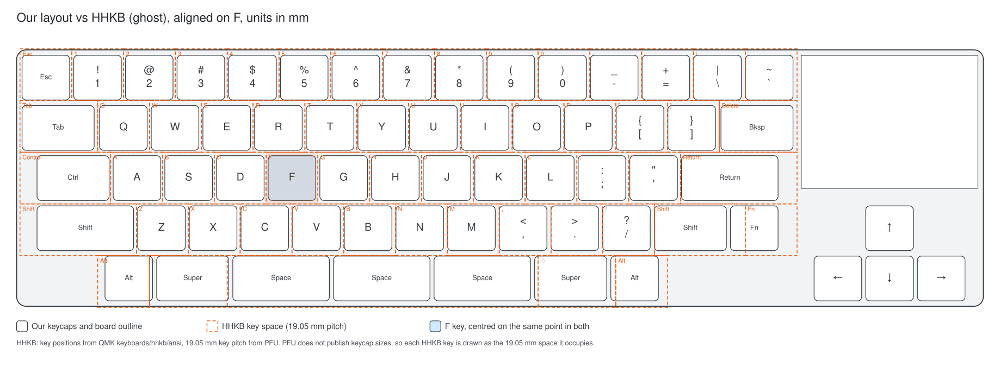
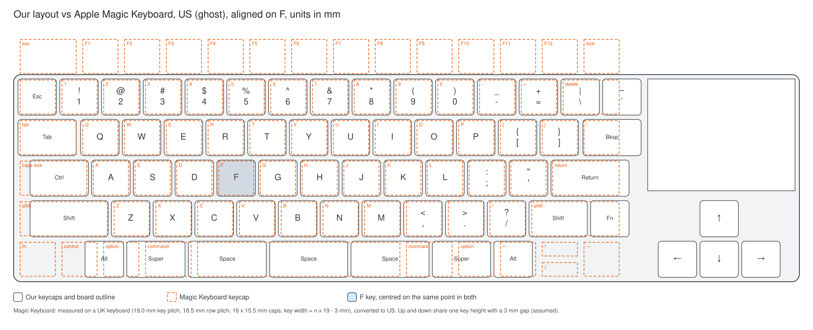

# HWKB: Happy Witching Keyboard

A wireless, low-profile mechanical keyboard with a built-in touchpad. It uses a Unix layout in the style of the Happy Hacking Keyboard and works both at a desk and on the couch with a media center.

Layout inspired by the Happy Hacking Keyboard (HHKB), a trademark of PFU Limited. This project is not affiliated with or endorsed by PFU.

## What you get

If you build one, you get:

- A Bluetooth keyboard and touchpad in one device, running from a rechargeable battery.
- Kailh Choc low-profile switches under multicolor 3D-printed keycaps.
- A thin chassis made from two PCBs soldered into one 3.2 mm slab.
- Open hardware and firmware you can change.

[docs/product.md](docs/product.md) lists every feature.

## How the layout compares

Each image draws our keycaps over a dashed ghost of another keyboard, with both F keys centred on the same point.

### HHKB

The letter keys sit within 0.25 mm of the HHKB's across. Our rows are 0.55 mm closer together, and our modifiers are narrower to fit Choc keycap sizes.

### Apple Magic Keyboard, US layout

The letter keys use the same 19.0 mm key pitch and 18.5 mm row pitch as the Magic Keyboard. Our keycaps are 1.5 mm wider and 1 mm deeper, so the gaps between them are narrower.

## Repository layout

| Directory    | Contents                                        |
| ------------ | ----------------------------------------------- |
| `docs`       | Product spec and images                         |
| `hardware`   | KiCad project                                   |
| `firmware`   | Firmware for the nRF54LM20A controller          |
| `production` | Gerbers and bill of materials for manufacturing |

## Status

Early design. Nothing is ready to build yet.
